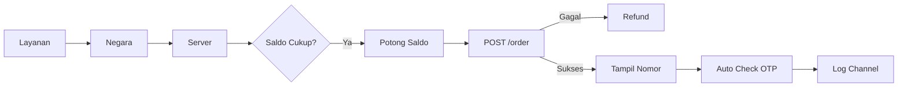
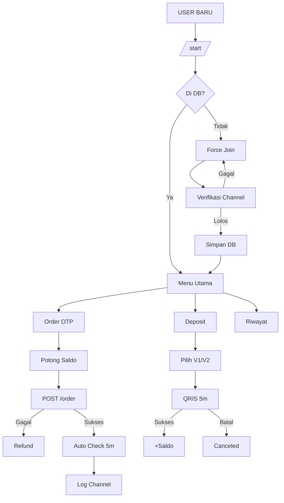

<div align="center">

# ☠ WARUNG NOKOS BOT

**Auto Order OTP Premium · Deposit QRIS Otomatis 24 Jam**

Bot Telegram terintegrasi dengan `warungnokos.web.id` & `qris.zakki.store`


</div>

---

## 📑 Daftar Isi

- [Gambaran Umum](#-gambaran-umum)
- [Struktur Proyek](#-struktur-proyek)
- [Konfigurasi](#️-konfigurasi)
- [Fitur User](#-fitur-user)
- [Fitur Admin](#️-fitur-admin)
- [Helper & Utility](#-helper--utility)
- [Alur Sistem](#-alur-sistem)
- [Catatan Teknis](#️-catatan-teknis)
- [Instalasi](#-instalasi)

---

## 🚀 Gambaran Umum

Bot Telegram berbasis `node-telegram-bot-api` untuk layanan **Nomor Virtual (Nokos)** otomatis dengan sistem **deposit QRIS** terintegrasi dua gateway.

| Kapabilitas | Deskripsi |
|-------------|-----------|
| 🛒 **Order OTP** | Verifikasi WhatsApp, Telegram, dll. |
| 💳 **Deposit QRIS** | Dua jalur: V1 WarungNokos & V2 Zakki |
| 🛡️ **Panel Admin** | Manajemen user, saldo, transaksi, backup |
| 🔔 **Log Channel** | Notifikasi real-time dengan sensor privasi |

---

## 📂 Struktur Proyek

```bash
📦 warung-nokos-bot
├── 📁 database
│   ├── users.json              # Data user (id, nama, saldo, tgl daftar)
│   ├── transaksi_users.json    # Riwayat order OTP
│   ├── deposit_users.json      # Riwayat deposit
│   └── settings.json           # Toggle V1 / V2
├── 🖼️ foto.jpg                 # Banner menu utama
├── ⚙️ config.js                # Kredensial & konfigurasi
└── 📜 index.js                 # Entry point bot
```

---

## ⚙️ Konfigurasi

Buat file `config.js` di root project:

```js
module.exports = {
  // Telegram
  BOT_TOKEN:       'xxx',
  ADMIN_ID:        'xxx',
  CHANNEL_ID:      '-100xxx',
  LOG_CHANNEL:     '-100xxx',
  LINK_CHANNEL:    'https://t.me/xxx',
  LINK_BUY:        'https://t.me/xxx',
  WEB_URL:         'https://xxx.com',
  CS_URL:          'https://t.me/xxx',

  // API WarungNokos
  API_KEY:         'xxx',
  API_BASE:        'https://warungnokos.web.id/api/smscode',
  API_DEPOSIT:     'https://warungnokos.web.id/api/deposit',

  // API Zakki (Deposit V2)
  ZAKKI_TOKEN:     'xxx',

  // Fee
  FEE_PERCENT:         5,   // fee order OTP (%)
  FEE_DEPOSIT_PERCENT: 0.7, // fee deposit (%)
};
```

---

## 👤 Fitur User

### 1. `/start` — Registrasi & Force Join

- Cek user di database
- Belum terdaftar → **wajib join channel** (`CHANNEL_ID`)
- Verifikasi via `bot.getChatMember`
- Lolos → simpan ke DB + notifikasi ke `LOG_CHANNEL`

### 2. Menu Utama

Banner `foto.jpg` + info akun:

```
👤 Username · 🆔 ID · 💰 Saldo · 📥 Total Deposit · 🛒 Total Belanja
```

| Tombol | Aksi |
|--------|------|
| 🛒 Order Nokos Sekarang | Daftar layanan |
| 💳 Isi Saldo | Menu deposit |
| 📜 Riwayat Transaksi | Deposit & OTP |
| 📢 Join Channel | Link channel |
| 🛍️ Buy Script | Link pembelian |

### 3. 🛒 Alur Order OTP



- **Layanan** → pagination 10/halaman, emoji dibersihkan
- **Negara** → filter stok > 0
- **Server** → maks 10 produk, harga final = `price + fee`
- **Buy** → validasi saldo → potong → order → refund jika gagal
- **Auto Check** → polling 5 detik × 60x (5 menit)
- **Cancel** → validasi 2 menit, refund penuh

### 4. 💳 Alur Deposit

| V1 — WarungNokos | V2 — Zakki |
|------------------|------------|
| `POST /deposit/create` | `POST /topupv2` |
| Retry otomatis saat `ECONNRESET` | QRIS URL |
| QRIS buffer (base64) | Token `ZAKKI_TOKEN` |

**Nominal Cepat**: `2.000 · 5.000 · 10.000 · 25.000 · 50.000 · 100.000` + **Manual** (min. 1.000)

**Mekanisme**:
- ⏱️ Expired 5 menit
- ❌ Batal manual setelah 1 menit
- 🔍 Cek status realtime
- ✅ Sukses → saldo bertambah + log channel

### 5. 📜 Riwayat Transaksi

**Riwayat Deposit** — Legenda warna:

| Warna | Status |
|-------|--------|
| 🟢 Hijau | Sukses |
| 🔵 Biru | Pending |
| 🔴 Merah | Batal / Kadaluarsa |

**Riwayat OTP** — format tombol: `{layanan} • {status} • {4 digit nomor}`

**Detail OTP** — 3 layout dinamis:

| Status | Fitur |
|--------|-------|
| `completed` | Copy Nomor · Copy OTP · Beli Lagi · Laporkan |
| `waiting` | Cek Status · Batalkan · Copy Nomor |
| `canceled` | Refund info · Beli Lagi |

---

## 🛡️ Fitur Admin

> 🔒 **Akses**: hanya `ADMIN_ID` via `/adminmenu`

### 1. 📋 List User

**Statistik Global** — Total deposit, belanja, saldo, user & halaman

**Leaderboard** — User diurutkan berdasarkan belanja:

| Rank | Warna Tombol |
|------|--------------|
| 🥇 1 | 🟢 Hijau (`success`) |
| 🥈 2 | 🔵 Biru (`primary`) |
| 🥉 3 | 🔴 Merah (`danger`) |
| 4+ | ⚪ Default |

### 2. 👤 Detail User

Info lengkap + aksi:
- ✏️ **Edit Saldo** — form force-reply (`+10000` / `-5000`)
- 📊 **Semua Transaksi** — gabungan deposit & OTP

### 3. 💰 Edit Saldo

```
Admin reply: +10000  →  tambah saldo
             -5000   →  kurangi (clamp min 0)
```

**Alur**:
1. Validasi regex `^([+-])(\d+)$`
2. Update DB
3. Hapus pesan lama
4. Notifikasi admin + user

### 4. 🧾 Detail Deposit Admin

| Status | Aksi |
|--------|------|
| `success` | Info saldo sebelum & sesudah |
| `pending` | 🔔 Kirim Pengingat ke User |
| `canceled` | Alasan pembatalan |

### 5. ⚙️ Settings Deposit

Toggle sakelar V1 / V2:

```
🟢 Aktif    → tombol biru
🔴 Nonaktif → tombol merah
```

### 6. 💾 Backup Script

- Kompresi `archiver` level 9
- **Tanpa** `node_modules`
- Kirim via `sendDocument`
- Auto-delete setelah terkirim

---

## 🧩 Helper & Utility

### 📁 Database

| Fungsi | File |
|--------|------|
| `bacaDatabase()` · `simpanDatabase()` | `users.json` |
| `bacaTrx()` · `simpanTrx()` | `transaksi_users.json` |
| `bacaDeposit()` · `simpanDeposit()` | `deposit_users.json` |
| `bacaSettings()` · `simpanSettings()` | `settings.json` |

### 🛠️ Utility

| Fungsi | Kegunaan |
|--------|----------|
| `generateTrxId()` | ID 10 karakter |
| `formatRp()` | Format `id-ID` |
| `bersihkanEmoji()` | Strip emoji |
| `chunkArray()` | Grid tombol |
| `sensorUsername()` | `june7829` → `jun***29` |
| `sensorNomor()` | `08214...` → `0821****1890` |
| `safeEdit()` | Edit aman (anti "not modified") |
| `formatWaktuRiwayat()` | `11 Nov 2025, 21:00 WIB` |

### 🌐 API Integrations

**Order OTP**
```
createOrder()  ·  checkOrderStatus()  ·  cancelOrder()
```

**Deposit V1**
```
createDeposit()  ·  checkDepositStatus()  ·  cancelDeposit()
```

**Deposit V2 (Zakki)**
```
createDepositV2()  ·  checkDepositStatusV2()  ·  cancelDepositV2()
```

### 🖥️ UI Render

```
showMainMenu()  ·  tampilkanMenuAdmin()
tampilkanPesanWajibJoin()  ·  prosesDepositV1()  ·  prosesDepositV2()
```

---

## 🔄 Alur Sistem



---

## 🛠️ Catatan Teknis

| Aspek | Implementasi |
|-------|--------------|
| 🛡️ **Anti double order** | Potong saldo dulu, refund jika gagal |
| ⏱️ **Timer validasi** | Order ≥ 2m · Deposit ≥ 1m |
| 🔄 **Retry network** | 1x otomatis saat `ECONNRESET` |
| 🧯 **Global handler** | `uncaughtException` + `unhandledRejection` |
| 🔐 **Privasi log** | Username & nomor disensor |
| ✏️ **safeEdit** | Anti "message not modified" |
| 🎯 **Force reply** | Selective per user |

---

## 📦 Instalasi

```bash
# 1. Clone & install
git clone <repo>
cd warung-nokos-bot
npm install

# 2. Setup
# - Buat config.js
# - Buat folder database/
# - Siapkan foto.jpg

# 3. Jalankan
node index.js
```

**Checklist**:

- [x] `foto.jpg` di root
- [x] Folder `database/` dibuat
- [x] `config.js` valid
- [x] Bot dijadikan **admin channel** (untuk force join)

---

<div align="center">

### ☠ WARUNG NOKOS BOT

**Auto Order OTP Premium · 24/7 Online**

<sub>Built with ❤️ for premium experience</sub>

</div>